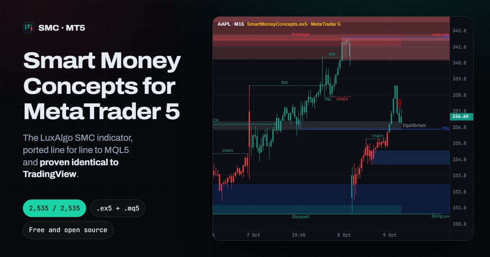
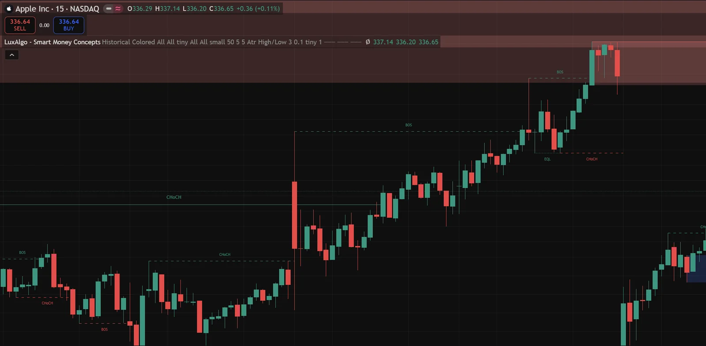
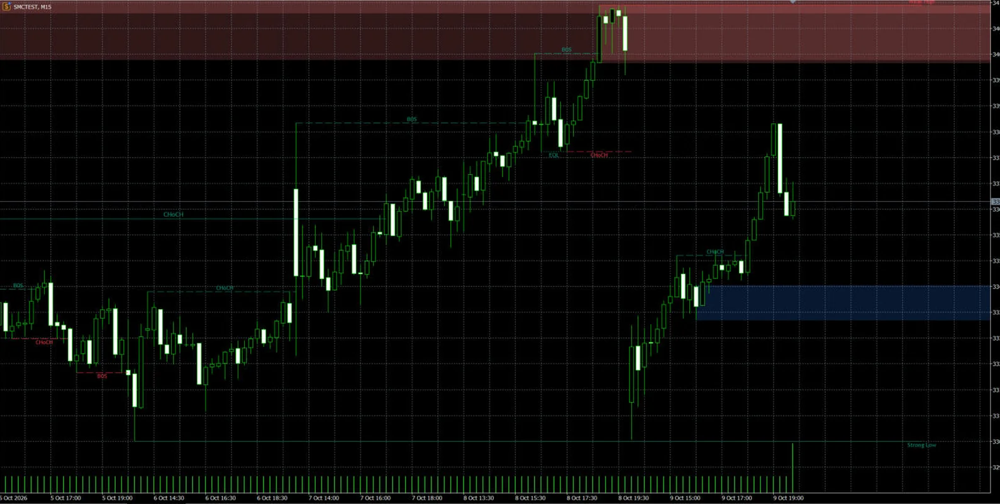

<div align="center">

# Smart Money Concepts for MetaTrader 5

**The LuxAlgo Smart Money Concepts (SMC) indicator, ported line for line to MQL5 and proven identical to TradingView.**
Free `.ex5` to run it now, free `.mq5` source to read every line.

[](https://github.com/GeneralTradingSarl/Smart-Money-Concepts/releases/latest)
[](https://github.com/GeneralTradingSarl/Smart-Money-Concepts/releases)


[](LICENSE)

[**Website**](https://smart-money-concepts-mt5.vercel.app/) ·
[**Download .ex5**](https://github.com/GeneralTradingSarl/Smart-Money-Concepts/releases/download/v1.0.0/SmartMoneyConcepts.ex5) ·
[**Download .mq5**](https://github.com/GeneralTradingSarl/Smart-Money-Concepts/releases/download/v1.0.0/SmartMoneyConcepts.mq5) ·
[**Interactive proof**](https://smart-money-concepts-mt5.vercel.app/proof/) ·
[**Guide**](https://smart-money-concepts-mt5.vercel.app/guide/)

<a href="https://smart-money-concepts-mt5.vercel.app/"></a>

English · [Français](https://smart-money-concepts-mt5.vercel.app/fr/) · [Español](https://smart-money-concepts-mt5.vercel.app/es/) · [Português](https://smart-money-concepts-mt5.vercel.app/pt/) · [Русский](https://smart-money-concepts-mt5.vercel.app/ru/) · [中文](https://smart-money-concepts-mt5.vercel.app/zh/)

</div>

## What it draws

The whole script, with the same input names, defaults and groups as the TradingView original:

- **Market structure**: Break of Structure (**BOS**) and Change of Character (**CHoCH**), internal (5-bar swings) and swing (50 bars by default), optional confluence filter
- **Order blocks**: internal and swing, bullish and bearish, filtered by ATR or cumulative mean range, mitigated on High/Low or Close
- **Equal highs and lows** (EQH / EQL) with threshold and confirmation length
- **Fair value gaps** (FVG) on the chart timeframe or a higher one, auto threshold, extension
- **Premium, equilibrium and discount zones**
- **Strong / weak highs and lows**, HH / HL / LH / LL swing points
- **Previous day, week and month** highs and lows (PDH/PDL, PWH/PWL, PMH/PML)
- **Trend-coloured candles** and the **16 alerts** of the original (popup, push notification, email)
- **Historical** or **Present** mode, **Colored** or **Monochrome** style

Works on any symbol and timeframe MetaTrader 5 can chart: forex, gold (XAUUSD), indices, crypto, stocks.

## Proof: identical to TradingView, object by object

LuxAlgo’s Pine script ran on TradingView, the same 5,044 AAPL 15-minute candles were loaded into MetaTrader 5, and every drawing was exported from both platforms and compared on time, price, text, colour, style and size.

| Config | Settings | Labels | Lines | Boxes | Trend colour |
|---|---|---|---|---|---|
| A | default settings | 327/327 | 327/327 | 5/5 | 5,044/5,044 |
| B | every feature on (swings, swing OBs, FVG, D/W/M levels, zones) | 409/409 | 333/333 | 47/47 | 5,044/5,044 |
| C | Present, Monochrome, confluence, cumulative mean range, Close mitigation, 20-bar swings, FVG on 30 min | 13/13 | 8/8 | 70/70 | 5,044/5,044 |
| D | config C in Historical mode (hits Pine’s 500-label limit) | 500/500 | 426/426 | 70/70 | 5,044/5,044 |
| A, B real time | last 44 bars replayed tick by tick (176 ticks) | identical | identical | identical | identical |

The only gap comes from data, not code: TradingView reads weekly and monthly levels from its own W and M bars (342.988), MT5 rebuilds them from the chart’s bars (342.98, the true high). The anchors are identical.

See it for yourself in the [interactive proof viewer](https://smart-money-concepts-mt5.vercel.app/proof/) (blink between the two platforms on the same bars), or re-run the bench from this repository:

```bash
python parity/compare.py A B C D Art Brt
```

| TradingView, original LuxAlgo script | MetaTrader 5, this port |
|---|---|
|  |  |

### Where MetaTrader forced a different mechanism, never a different result

1. **Real-time rollback**: the forming bar is computed on a throwaway copy of the state, discarded at the next tick; only closed bars are committed, like Pine.
2. **Object limits**: labels, lines and boxes go through an in-memory collection that enforces Pine’s 500-object limits, oldest deleted first.
3. **Transparency**: MT5 objects have no alpha channel, so boxes are painted on a transparent canvas with real alpha blending. Each `color.new(c, t)` becomes a colour plus a transparency input.
4. **Float tolerance**: Pine compares numbers with an absolute `1e-10` tolerance (`0.1 + 0.2 == 0.3` is true). The port reproduces it.

## Install

1. Download [`SmartMoneyConcepts.ex5`](https://github.com/GeneralTradingSarl/Smart-Money-Concepts/releases/download/v1.0.0/SmartMoneyConcepts.ex5) (or the `.mq5`).
2. In MetaTrader 5: **File › Open Data Folder › MQL5 › Indicators**, drop the file there.
3. In the Navigator, right-click **Indicators › Refresh**.
4. Drag **SmartMoneyConcepts** onto a chart. Settings and alerts are in the **Inputs** tab.

With the source: open `SmartMoneyConcepts.mq5` in MetaEditor (F4) and press **Compile** (F7), 0 errors, 0 warnings. One file, about 2,300 lines, no include, no DLL.

Full guide, alerts setup and troubleshooting: [smart-money-concepts-mt5.vercel.app/install](https://smart-money-concepts-mt5.vercel.app/install/). Every setting with its default: [guide](https://smart-money-concepts-mt5.vercel.app/guide/#settings).

| File | SHA-256 |
|---|---|
| `SmartMoneyConcepts.ex5` | `cbb5afeee53174efc9cb2f9876d7915c7472b286481b18e8e618a89cc33ea19d` |
| `SmartMoneyConcepts.mq5` | `0a575d0047b5b938b821a319eeb4002fe414598bb2c016dd6e9429fc6d2460c8` |

## Support the project

Free for everyone, and it stays free. If it saves you time or helps your trading, a donation of **any amount** is welcome, even one dollar.

| Network | Address |
|---|---|
| **USDT on TRON (TRC-20)** | `TULMdmDTh5tuWhMNfUNAWCN9vASh5JqAzf` |
| **BNB Smart Chain (BEP-20)**: BNB, USDT, USDC… | `0xC2D08CD5277587325bABC2111F54b5E0A7ec8F12` |

Check the network before sending: anything sent on the wrong network is lost. QR codes are on the [website](https://smart-money-concepts-mt5.vercel.app/#support). A donation is not a payment: the downloads stay free either way.

## Custom work

I’m **Ismael Ladjohounlou**, the developer behind this port. I can adapt this indicator to your trading (your rules, extra alerts, labels in your language, multi-timeframe view, signal buffers for an Expert Advisor) or build anything else for MetaTrader, TradingView or Telegram:

- **TradingView Pine Script to MQL5 / MQL4**, with the same object-by-object parity report as here ([how it works](https://smart-money-concepts-mt5.vercel.app/pine-script-to-mql5/))
- **Expert Advisors** for MT4 / MT5 (SMC and ICT models, multi-timeframe entries, prop-firm risk rules), full source delivered
- **Backtests you can trust**, with an independent Python reference
- **Telegram** signal bots, trade copiers and EA control panels

Email **general.trading.bot.2025@gmail.com**, open an [issue](https://github.com/GeneralTradingSarl/Smart-Money-Concepts/issues/new), or find me on [LinkedIn](https://www.linkedin.com/in/ismaelladjohounlou) and [MQL5](https://www.mql5.com/en/users/ismael_financial_bot). The quote is free.

Want more than the original? **[Structura](https://www.mql5.com/en/market/product/201556)** is my own Smart Money engine for MT5, written from scratch: order blocks scored 0 to 3, breakers, inverse FVGs, liquidity sweeps, OTE zones, multi-timeframe dashboard, 6 EA buffers, proven non-repainting ([82-second demo](https://youtu.be/x35L5b2P_xY)).

## FAQ

**Is it the official LuxAlgo indicator?** No. It is an independent, unofficial MQL5 port of LuxAlgo’s open-source [Smart Money Concepts (SMC) [LuxAlgo]](https://www.tradingview.com/script/CnB3fSph-Smart-Money-Concepts-SMC-LuxAlgo/) script. LuxAlgo does not endorse it.

**Does it repaint?** It behaves exactly like the original: structure is confirmed on closed bars, the forming bar is recalculated each tick and committed at close, and swing points are confirmed after their lookback length, as in Pine.

**Can I sell it or put it on the MQL5 Market?** No. The licence forbids commercial use, for the original and for this port.

**Can an Expert Advisor read it?** With *Color Candles* on, an EA can read the trend from the colour buffer (buffer 4) with `iCustom`. For BOS / CHoCH / order block signal buffers, ask for an EA-ready version.

**MT4 version?** Not yet, on request.

## Repository

| Path | What |
|---|---|
| `SmartMoneyConcepts.mq5` / `.ex5` | the indicator, source and compiled |
| `parity/` | the test bench: original Pine script, test variants, TradingView exports, MT5 dumps, `compare.py` ([README](parity/README.md)) |
| `site/` | the website ([smart-money-concepts-mt5.vercel.app](https://smart-money-concepts-mt5.vercel.app/)), static, built by `python site/build.py` |
| `legacy/` | the previous build published here in 2025, kept for reference |

## Licence and attribution

Original work: **Smart Money Concepts (SMC) [LuxAlgo]** © LuxAlgo, licensed [CC BY-NC-SA 4.0](https://creativecommons.org/licenses/by-nc-sa/4.0/).
This MQL5 port © 2026 Ismael Ladjohounlou is a derivative work under the same licence: keep the attribution, non-commercial use only, share your changes under the same terms. See [LICENSE](LICENSE).

Independent project, not affiliated with, sponsored or endorsed by LuxAlgo, TradingView or MetaQuotes. Trading involves a substantial risk of loss; this indicator is an analysis tool, not financial advice.
