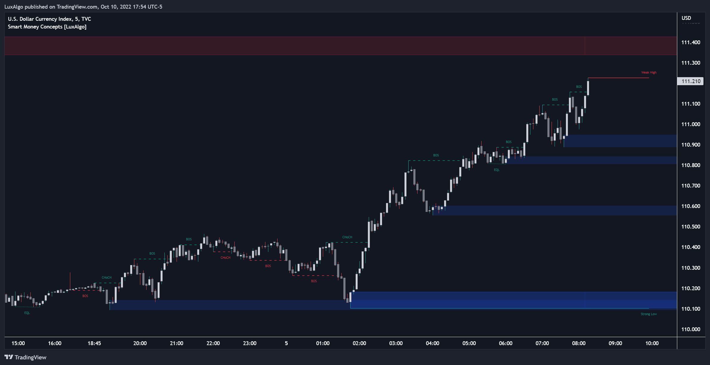
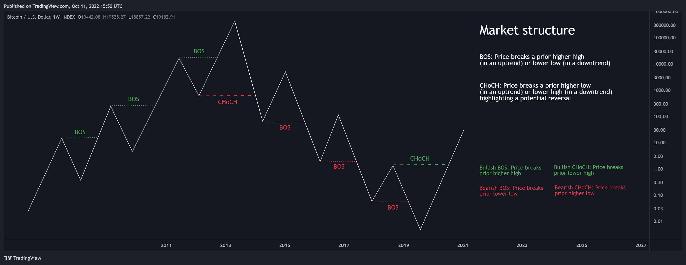
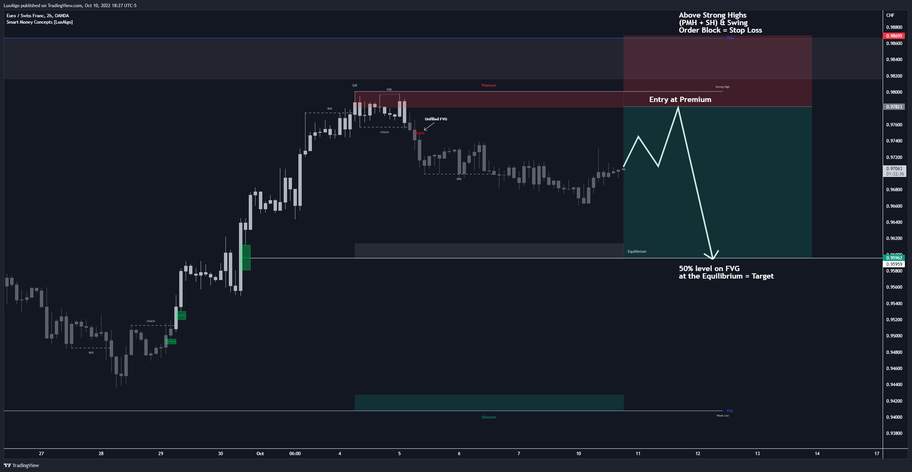
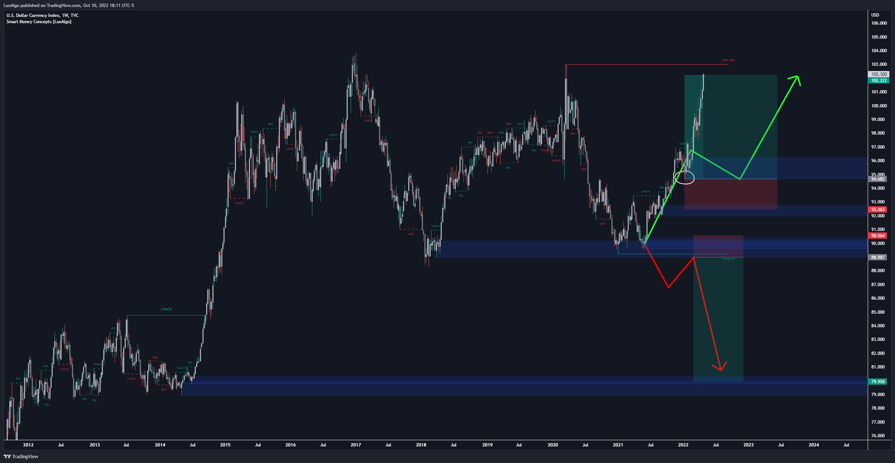
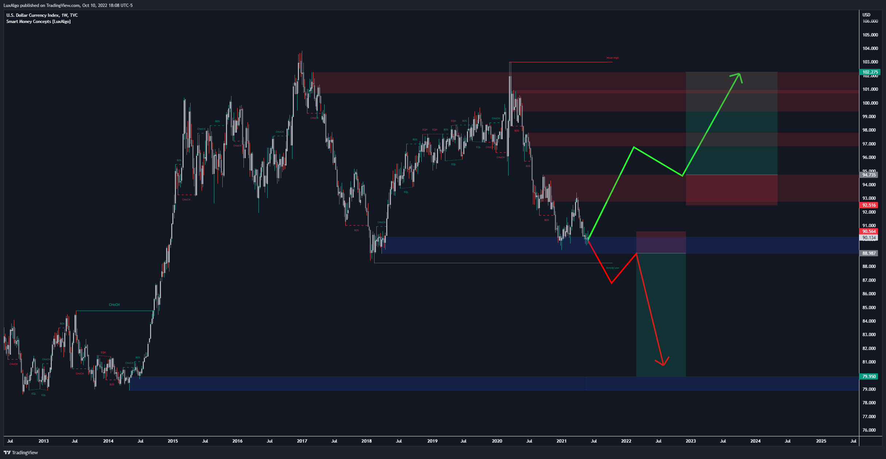

# Smart Money Concepts Indicator for MetaTrader 5

Institutional-style market analysis rendered directly on your chart: order blocks, liquidity zones, market structure, and fair value gaps.

## Overview

The Smart Money Concepts (SMC) indicator brings institutional-style market structure analysis to MetaTrader 5: market structure shifts, liquidity grabs, order blocks, and fair value gaps, all rendered directly on your chart. Built for traders who follow Smart Money Concepts and ICT-style methodology on forex, indices, and crypto.

## Features

- Automatic market structure detection: Break of Structure (BOS) and Change of Character (CHoCH)
- Order block and liquidity zone visualization
- Premium / Discount price zones
- Fair Value Gap (FVG) highlighting
- Clean, customizable colors and labels
- Lightweight and fast on any MetaTrader 5 chart

## Screenshots

## Installation

1. Download the `.ex5` file from this repository.
2. Copy it into the `Indicators` folder of your MetaTrader 5 data folder.
3. Restart MetaTrader 5 and attach the indicator to any chart.

## Documentation

Indicator parameters are documented directly in the source code (`.mq5`).

## Tags

`smart-money-concepts` `order-blocks` `liquidity` `market-structure` `fair-value-gap` `ict-concepts` `forex` `metatrader5` `mql5` `trading-indicator` `open-source`

## Need something custom?

This repository is a free reference. If you need an Expert Advisor built or fixed, an indicator ported from MQL4 to MQL5, a Telegram signal bot, or a trade copier, I build them to order and deliver the full source code.

- Portfolio: https://ismael-portfolio-liard.vercel.app/en
- All my work: https://github.com/GeneralTradingSarl
- Email: general.trading.bot.2025@gmail.com

## Author

Built by [Ismael LADJOHOUNLOU](https://github.com/GeneralTradingSarl). Star the repository if you find it useful, and feel free to open issues or pull requests.
